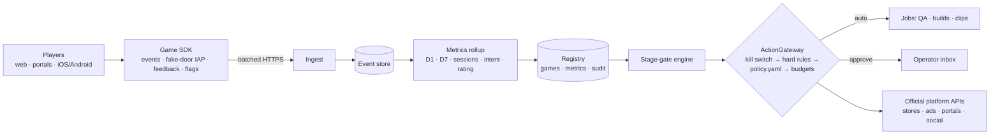

<div align="center">

# 🎮 Studio in a Box

**Small mobile games, from idea to worldwide launch, with a human only where it matters.**

[](https://github.com/bspindler/gstudio/actions/workflows/ci.yml)


[Quick start](#-quick-start) · [Make a game](#-make-your-first-game) · [How it works](#-how-it-works) · [Contributing](#-contributing) · [Docs](#-docs)

</div>

---

Studio in a Box is a platform that runs a tiny game studio largely on its own. It keeps the game library, builds and tests every game, measures how real players respond, and moves each game through a **stage-gate pipeline**, from concept to web test to store launch and on to new markets. People are pulled in only for approvals, decisions, or when the system is stuck.

Every outside action (spending, posting, store submissions, price changes, kills) goes through one **gateway** that checks the kill switch, the hard rules, the operator's `policy.yaml` and the budget caps before anything happens.

## 📚 Table of contents

- [Features](#-features)
- [Quick start](#-quick-start)
- [Make your first game](#-make-your-first-game)
- [How it works](#-how-it-works)
- [The stage-gate pipeline](#-the-stage-gate-pipeline)
- [Hard rules](#%EF%B8%8F-hard-rules)
- [Scripts](#-scripts)
- [Project structure](#%EF%B8%8F-project-structure)
- [Tech stack](#-tech-stack)
- [Contributing](#-contributing)
- [Docs](#-docs)
- [Status and roadmap](#%EF%B8%8F-status-and-roadmap)
- [License](#-license)

## ✨ Features

- 🕹️ **HTML5 games with no build step.** Each game is one folder in `games/`: an `index.html` plus a `game.yaml`.
- 🧰 **One small game SDK** for events, fake-door purchases, feedback prompts, A/B flags and reward odds. It uses anonymous IDs only.
- 🚦 **Stage gates driven by real metrics:** D1 and D7 retention, session length, purchase intent, rating and crash-free rate, with policy-set bars per channel.
- 🛡️ **Guardrails built in.** The `ActionGateway` is the only route to the outside world, and `policy.yaml` decides what runs automatically and what waits for approval.
- ✅ **Automatic compliance checks** on every file of every game: no dark patterns, no paid random rewards, purchases only through the SDK, and no direct network calls.
- 🌱 **`npm run new-game`** creates a compliant starter game in one command.
- 📱 **Play on your phone** over home Wi-Fi with `npm run dev:lan`.
- 🌐 **Test builds on GitHub Pages:** hidden from search, labelled "test build", and nothing collected.
- 💻 **Local-first.** SQLite and filesystem adapters mean you never need Azure to develop, on Windows, macOS or Linux.

## 🚀 Quick start

**You need:** [Node 22](https://nodejs.org/) and [Git](https://git-scm.com/). On Windows, see [`docs/START-HERE.md`](docs/START-HERE.md) for a step-by-step setup.

```bash
git clone https://github.com/bspindler/gstudio.git
cd gstudio
npm install
npm test          # every workspace, including the game compliance checks
npm run seed      # register the games locally (stage 2)
npm run dev       # API + ingest on :8787, games on :5174
```

Open <http://localhost:5174/> and pick a game. Local data lives in `.data/` (git-ignored); delete that folder to start fresh.

## 🌱 Make your first game

```bash
npm run new-game star-catcher
npm run dev
```

Then open <http://localhost:5174/star-catcher/> and start changing the `CHANGE ME` spots in `games/star-catcher/index.html`: the colours, speed, title and lives.

**On your phone:** run `npm run dev:lan` instead, connect the phone to the same home Wi-Fi, and open the address it prints.

## 🧭 How it works



Core logic has no Azure dependency. Storage, queues, secrets and notifications sit behind ports, with local adapters for development and Azure adapters for production. The full design is in [`docs/architecture.md`](docs/architecture.md).

## 🚦 The stage-gate pipeline

| Stage | Name | What moves a game forward |
|---|---|---|
| 0 | Concept | Concept score ≥ 0.6 |
| 1 | Prototype | QA passed and bot-playable |
| 2 | Web test | ≥ 200 players, rating ≥ 3.8, D1 ≥ 15% on portals or ≥ 30% on our own site |
| 3 | Beta | Crash-free ≥ 99.5% and store-ready |
| 4 | Soft launch | D1 ≥ 35%, D7 ≥ 12%, LTV/CPI ≥ 1.0 |
| 5+ | Expansion → Live ops → Sunset | Market by market, with approval |

Stages 0–2 can advance automatically. From stage 3 on, every step needs the operator's approval. The bars live in [`policy.yaml`](policy.yaml), which the operator owns.

## 🛡️ Hard rules

These are never configurable.

1. **No real-money gambling, no crypto, no tokens, no prizes with cash value.** Random rewards are earned only, never bought, and always show their odds.
2. **Follow every platform's rules.** Use official APIs only: no bots that pretend to be people, no fake accounts or reviews, no bought engagement, no scraping where the terms forbid it.
3. **No real charges outside official store billing.** During web tests, purchase buttons are honest fake doors: the item is free during the beta.
4. **Protect minors.** No personal data from under-13s, honest age ratings, and no dark patterns: no fake timers, fake scarcity, or pressure after a "no".
5. **Privacy-light by default.** Players get anonymous IDs, and store privacy labels match what we actually collect.
6. **Original IP only.**
7. **Secrets live in Azure Key Vault,** never in the repo, accessed with least-privilege managed identities.

## 🧪 Scripts

| Command | What it does |
|---|---|
| `npm test` | Run every test with vitest, including game compliance |
| `npm run typecheck` | Strict TypeScript across all workspaces |
| `npm run dev` | API + ingest on :8787 and games on :5174, localhost only |
| `npm run dev:lan` | The same, also on your home network so a phone can play |
| `npm run new-game <slug>` | Create a compliant starter game in `games/<slug>/` |
| `npm run build:pages` | Build the GitHub Pages test-build site into `_site/` |
| `npm run seed` | Register every game in the local registry |
| `npm run rollup` | Turn raw events into metric snapshots |
| `npm run gates` | Run one stage-gate cycle |
| `npm run demo:1b` | Run synthetic players through the real ingest (local only) |
| `npm run lint:infra` | Validate the Bicep templates (needs the Azure CLI) |

## 🗂️ Project structure

```
games/<slug>/        HTML5 games (no build step) + game.yaml
packages/core/       domain, policy, registry, gateway, gates, metrics rollup, game library + compliance
packages/sdk/        browser game SDK (plain ES module, no dependencies)
adapters/local/      SQLite registry, filesystem object store
services/api/        Hono app: ingest + API, jobs (seed, rollup)
scripts/             dev server, new-game, Pages build, seed, rollup, gates, demos
infra/               Azure Bicep
policy.yaml          autonomy policy, gates and budgets (operator-owned)
markets.yaml         market tiers
docs/                design, platform research, plans, contributor guide
```

## 🧱 Tech stack

**TypeScript** (strict, ESM) · **Node 22** · npm workspaces · **vitest** · **Hono** · `node:sqlite` · plain-JS game SDK · **Azure** (Functions, Cosmos DB, Blob, Queues, Key Vault) via **Bicep** · **GitHub Actions** (CI on Linux and Windows, Pages)

## 🤝 Contributing

New here? Start with **[`docs/START-HERE.md`](docs/START-HERE.md)**. It's a friendly guide from a fresh laptop to your own game on your phone, written for Windows. Then read [`CONTRIBUTING.md`](CONTRIBUTING.md).

The short version:

1. Make a branch: `git switch -c my-change`.
2. Make your change and keep `npm test` green.
3. Push and open a pull request. CI runs on Linux and Windows, and the operator reviews it.

If you use Claude Code, copy the templates in [`docs/contributor/`](docs/contributor/) for tutor-style help and safe permissions.

## 📖 Docs

| Doc | What's in it |
|---|---|
| [`docs/START-HERE.md`](docs/START-HERE.md) | Beginner's guide: setup, first game, phone, Git |
| [`docs/architecture.md`](docs/architecture.md) | The approved design |
| [`docs/game-studio-prompt.md`](docs/game-studio-prompt.md) | The original brief |
| [`docs/platforms/`](docs/platforms/) | Platform research: Apple, Google Play, ads, portals, social, markets |
| [`docs/STATUS.md`](docs/STATUS.md) | Plan status, operator setup, decisions and known issues |
| [`CLAUDE.md`](CLAUDE.md) | Rules and conventions for AI agents working in this repo |

## 🗺️ Status and roadmap

- [x] **1a:** foundation core: registry, stage-gate engine, ActionGateway, audit log
- [x] **1b:** game SDK, event ingest, metrics rollup, local adapters
- [x] **Onboarding:** Windows support, `new-game`, compliance for every file, Pages test builds
- [ ] **1c:** operator console, public portal, Azure adapters, deploy to Azure

Details are in [`docs/STATUS.md`](docs/STATUS.md).

## 📄 License

Private and proprietary. All rights reserved. This repository is not open source.
