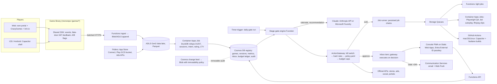

# Studio in a Box: Architecture Proposal (v0.4, Azure + Bicep, local-first, 2026-10-25)

Status: **proposal, awaiting Brian's approval.** Nothing is built yet. v0.1 targeted AWS; Brian switched the plan to Azure on 2026-10-25 to use Microsoft for Startups credits.

## Principles

- **Boring and cheap.** Serverless and consumption-billed services, with nothing that costs money while idle. Two subscriptions (dev, prod) in one Entra tenant. Region: East US 2. Infrastructure as code in **Bicep**, deployed as deployment stacks per environment, with `what-if` run in CI before each deploy. Bicep is Azure-native, has no state file to manage, and Azure supports new resource types on day one. TypeScript stays the language for all application code.
- **One choke point for side effects.** Every external action (spending money, posting, submitting to a store, publishing, changing a price, killing a game) goes through `ActionGateway`. In order, it checks:
  1. the kill switch
  2. the hard rules
  3. the action's class in `policy.yaml` (auto / notify / approve)
  4. the budget ledger

  Only the gateway's managed identity can read the spending and posting secrets. The guardrails live in code, not in prompts.
- **Claude judges, code decides.** Claude writes recommendations, rationale, and copy. Deterministic gate rules and the policy layer decide what actually happens.

## Diagram



## Components (AWS equivalent in brackets)

| Part | Choice | Why / trade-off |
|---|---|---|
| Registry | Cosmos DB for NoSQL, on the free tier (1000 RU/s and 25 GB free per account) [DynamoDB] | Free at our scale. One container per entity type, partitioned by game slug. |
| Audit log | Append-only documents, copied from the change feed into Blob storage with a time-based immutability (WORM) policy [S3 Object Lock] | Can't be tampered with. Each decision records its inputs: metric snapshot, policy version, and Claude's rationale. |
| Workflow | Persisted job chains on the queue, with no orchestration engine [Step Functions] | Approvals don't need a workflow engine. The gateway stores the pending action and executes it when you decide. Multi-step pipelines (build → QA → publish) are jobs that enqueue the next step and record progress in the registry. This keeps everything runnable locally; Durable Functions was dropped in v0.4. |
| Jobs | Storage Queues feeding Functions for light work, and Container Apps Jobs for Playwright and ffmpeg [SQS, Lambda, Fargate] | Container Apps has a monthly free grant and scales to zero. Clip rendering and 60s+ autoplays don't fit within Function time limits. |
| Compute | Azure Functions, Flex Consumption plan, Node 22 [Lambda] | Per-function managed identity and VNet support when needed. |
| Native builds | GitHub Actions (macOS runners for iOS), triggered from the orchestrator | Unchanged from v0.1. Azure has no cheap macOS build host either. |
| Analytics | SDK → Functions HTTP ingest → batched Parquet in ADLS Gen2 → nightly DuckDB rollups in a Container Apps Job → gate metrics written into the registry [Firehose, S3, Athena] | Azure's pay-per-query options are weak: Synapse serverless is legacy, and Fabric starts at about $260/mo for a capacity. DuckDB over Parquet is cheap, simple, and portable. Event Hubs is the upgrade path if volume grows. |
| Store/ad data | Timer-triggered pullers for App Store Connect reports, the Play `pubsite_prod_rev_*` bucket, and Apple Ads / Meta / TikTok reporting | Each metric carries a freshness timestamp, and gates respect the lag windows (3–7 days for Play, aggregated attribution for iOS). |
| Gate engine | Daily Function. Gate rules are declarative in `policy.yaml`, and Claude writes the rationale and flags anomalies | Rules decide pass/hold/kill. If Claude recommends overriding a rule, that always becomes an approve item. |
| Budget guard | Ledger in Cosmos, with spend polled hourly from the ad APIs. Platform-side lifetime budgets, end dates, and account spend caps act as a second layer | A cap hit pauses campaigns through the API and creates an Inbox item. The kill switch pauses all campaigns and cancels all scheduled posts. |
| Console | React + Vite PWA on Static Web Apps (Standard). Entra External ID with passkey or MFA [CloudFront + S3, Cognito] | Mobile-first: pipeline board, game pages, Inbox, budget burn, kill switch. Web Push through VAPID. |
| Web portal + game hosting | A static site generated from the registry, with a landing page at `/<slug>` plus the playable build. Hosted on Static Web Apps or on Blob storage behind Front Door, depending on egress | SEO, trailer, and waitlist (double opt-in email plus 13+ attestation). It also serves as the "working website" that Apple enrollment requires. |
| Agent layer | Claude through the Anthropic API, or through Microsoft Foundry if Azure credits can pay for it (**verify**). Prompts are versioned in the repo, outputs are structured JSON, and every call goes to the audit log | Used for concept ranking, gate rationale, the **distinctness check against the library** (App Store guideline 4.3 risk), clip scripts and captions, store copy, and feedback summaries. |
| Secrets/identity | Key Vault, managed identities, and least-privilege RBAC per Function [Secrets Manager, IAM] | Hard rule 7. Only the gateway identity can read the secrets used for spending and posting. |
| Email | Azure Communication Services Email [SES] | Used for escalations and waitlist opt-ins. |

## Local development (no Azure required)

All business logic sits behind small ports. Azure is one set of adapters, and local dev uses the other.

| Port | Local adapter | Azure adapter |
|---|---|---|
| `RegistryStore` | SQLite file (`node:sqlite`, built into Node 22) at `.data/registry.db`. Tests use `MemoryStore` | Cosmos DB |
| `JobQueue` | SQLite table polled by the in-process worker | Storage Queues |
| `ObjectStore` (events, clips, builds, audit archive) | `.data/objects/` on the filesystem | Blob storage / ADLS |
| `Secrets` | `.env.local` (gitignored) | Key Vault via managed identity |
| `Notifier` (email, push) | Terminal log, plus `.data/outbox/` | Communication Services + Web Push |
| `Auth` | Dev login, bound to localhost only | Entra External ID |
| `Clock` / scheduler | `npm run gates` (manual), or a cron in the dev server | Timer triggers calling the same handler |

- **One HTTP app.** The API and event ingest are a single Hono app. Locally it runs on Node; in Azure, a thin Functions adapter wraps the same app.
- **Analytics runs the same code everywhere.** DuckDB rollups read the local Parquet/NDJSON files, or the same files in ADLS.
- **`npm run dev`** starts the API and ingest (:8787), the console (:5173), the portal and games (:5174), and the worker. **`npm run seed`** loads Tidepool Pals and Hyperline.
- **Testing:**
  - vitest unit tests run on `MemoryStore`.
  - A shared **store contract suite** runs against every `RegistryStore` (Memory, SQLite, and Cosmos), so the adapters can't drift apart.
  - Playwright runs locally against `npm run dev`.
  - Azure adapters are tested only in a CI job against the dev subscription. Nothing local needs Azure.
- **Phone testing:** browse to the dev server over the LAN, or through a tunnel if needed.

## Repo layout (npm workspaces monorepo)

```
games/<slug>/          HTML5 game folders (no build step) + game.yaml metadata
packages/sdk/          shared game SDK (vanilla JS, no deps)
packages/core/         registry types, policy loader, gate rules, ActionGateway, budget ledger (no Azure deps)
adapters/local/        SQLite store + queue, filesystem objects, dev auth, console notifier
adapters/azure/        Cosmos, Storage Queues, Blob/ADLS, Key Vault, Comm Services, Entra
services/              Azure Functions apps (api, ingest, gates, pullers, inbox, orchestrations)
workers/               container images (qa-playwright, autoplay, clip-render, rollups)
apps/console/          operator PWA
apps/portal/           static portal generator
native/                Capacitor shell + fastlane
infra/                 Bicep modules + main.bicep, params per env (dev.bicepparam, prod.bicepparam)
policy.yaml  markets.yaml  CLAUDE.md  docs/
```

## Monthly cost estimate (before credits)

Assumed scale: 30 games, about 30k MAU / 10k DAU, about 2M events/day batched, about 50 clips/week, and about 10 native builds/week.

| Item | Est. $/mo |
|---|---|
| Functions Flex Consumption (ingest, API, gates, orchestrations) | 5–15 |
| Cosmos DB (free tier) | 0–5 |
| Storage: ADLS, Blob, Queues, audit WORM | 5–10 |
| Container Apps Jobs (QA, clips, rollups; free grant first) | 0–10 |
| Static Web Apps Standard (console + portal) | 18 |
| Game asset egress (~600 GB) via Front Door or SWA bandwidth | 40–90 |
| Key Vault, DNS, Communication Services, Entra External ID (free ≤50k MAU) | 3–5 |
| Application Insights / Log Analytics | 10–20 |
| **Azure subtotal** | **~$80–170** |
| GitHub Actions macOS minutes (~800 min) | ~50–65 |
| Claude (gate runs, copy, clips, concepts) | ~30–100, capped in policy |
| Apple Developer ($99/yr) + Play ($25 once) | ~10 amortized |
| **Platform total, excluding ad spend** | **~$170–345** |

This runs a little above the AWS estimate, mostly because of egress and the Static Web Apps base fees. Microsoft for Startups credits ($5k without investor backing) would cover the Azure subtotal for roughly 2.5–5 years, if Microsoft extends them past their initial expiry window (**verify the expiry terms**).

## Changes from the original prompt (from `docs/platforms/` research)

1. **Web-test D1 gate is set per channel.** On portals the bar is ≥ 15% or the top 25% (CrazyGames reports 10–15% D1 for strong games). On our own site with organic traffic it stays at ≥ 30%.
2. **New "new-game setup" Inbox item.** Each game needs about 15 minutes of manual work in the App Store Connect, Play Console, and CrazyGames consoles, which have no API for these steps.
3. **Distinctness check before Beta.** This covers App Store guideline 4.3 and Play's repetitive-content policy, and failing it puts the game on a hard hold.
4. **TikTok stays manual.** Clips are sent to the TikTok app as drafts and Brian taps post. Instagram and YouTube can be automated once their audits pass.
5. **Markets.**
   - Tier 3: PH, MY, TH, BR, MX. ID joins after its IGRS rating; VN is excluded.
   - Tier 2: CA, AU, NZ.
   - Tier 1: US, GB, then JP, KR, TW.
   - No paid random rewards in BR or AU builds.
